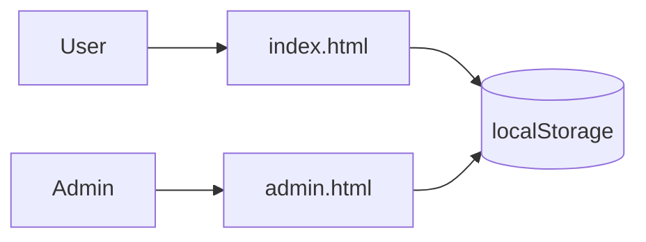
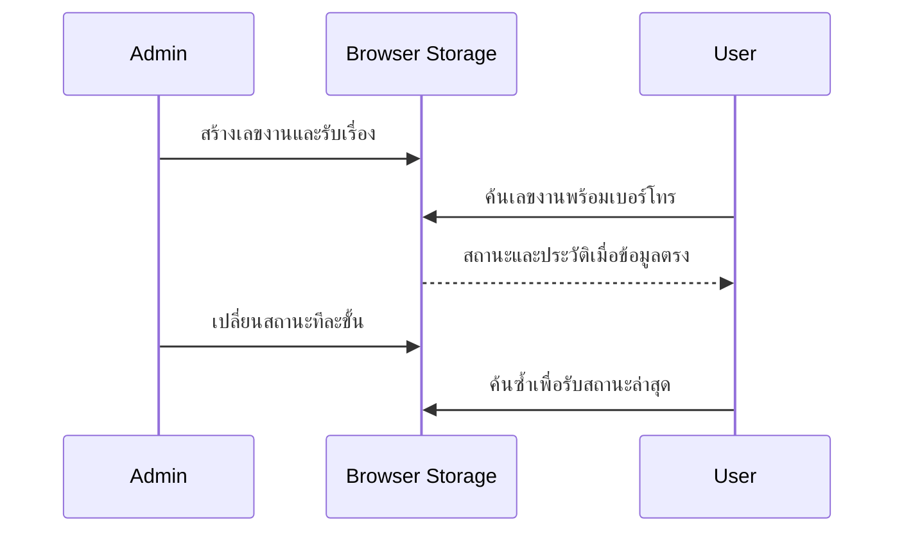

# Requirements และ System Design
FR01 รับงาน / FR02 ค้นหา / FR03 เปลี่ยนสถานะ / FR04 กรอง / FR05 เก็บข้อมูล
BR01 โทรเป็นเลข 10 หลัก; BR02 ทุกช่องห้ามว่างรวมช่องว่างล้วน; BR03 เลขงานไม่ซ้ำ; BR04 สถานะเดินหน้าทีละขั้น; BR05 งานส่งคืนแล้วไม่มีปุ่มเปลี่ยน
NFR01 ใช้งานหน้าจอ 390px ได้; NFR02 ข้อมูลข้อความแสดงเป็น text เพื่อไม่ให้ HTML ทำงาน

## Architecture
Browser UI → JavaScript → localStorage (repairJobs)
ต้นแบบ frontend เท่านั้น ไม่มี server API หรือการยืนยันตัวตน ห้ามใช้กับข้อมูลส่วนบุคคลจริง

## Use cases และ flow
เจ้าหน้าที่: เปิดหน้า → กรอก → ตรวจข้อมูล → สร้างเลขงาน → บันทึก → แสดงรายการ
ช่าง: ค้นงาน → ตรวจสถานะ → เลือกขั้นถัดไป → บันทึกประวัติ → render
ข้อผิดพลาด: ข้อมูลไม่ครบไม่สร้างงาน; ค้นไม่พบแสดงข้อความ

## Data model / logical ERD
RepairJob(id PK, customer, phone, device, issue, status)
RepairJob 1 — N StatusHistory(sequence, status)
ในต้นแบบ history ฝังเป็น array; ในระบบจริงแยกตารางและเพิ่ม changedAt, changedBy

## Sequence
User → Form.submit → validate → generate ID → jobs.push → localStorage.setItem → render → แจ้งเลขงาน

## UI
หัวเว็บ → ฟอร์มรับซ่อม → ข้อความผลลัพธ์ → ช่องค้นหาและกรอง → การ์ดรายละเอียดและประวัติ
ตัวอย่างข้อมูล: สมชาย / 0812345678 / Notebook / เปิดไม่ติด
ค่าขอบโทร: 9 หลักไม่ผ่าน, 10 ผ่าน, 11 ไม่ผ่าน

## แยกสองฝั่ง
index.html: หน้าลูกค้า ค้นด้วยเลขงาน + เบอร์โทร แสดงข้อมูลแบบอ่านอย่างเดียว
admin.html: รับงาน ค้นหา กรอง และเปลี่ยนสถานะ
ใช้ repairJobs ร่วมกันใน origin เดียว; ลูกค้าที่เปิดอยู่รับ storage event เมื่อ Admin อัปเดตอีกแท็บ
การแยกหน้าไม่ใช่ระบบควบคุมสิทธิ์: รุ่นใช้งานจริงต้องมี backend และ Admin login พร้อม authorization; เบอร์โทรไม่ใช่รหัสลับ

## แผนภาพระบบ

UI: styles.css ร่วมกัน; breakpoint 760px; navy/teal; Admin มีสถิติและสองคอลัมน์; ลูกค้ามีคำแนะนำและฟอร์มติดตาม
